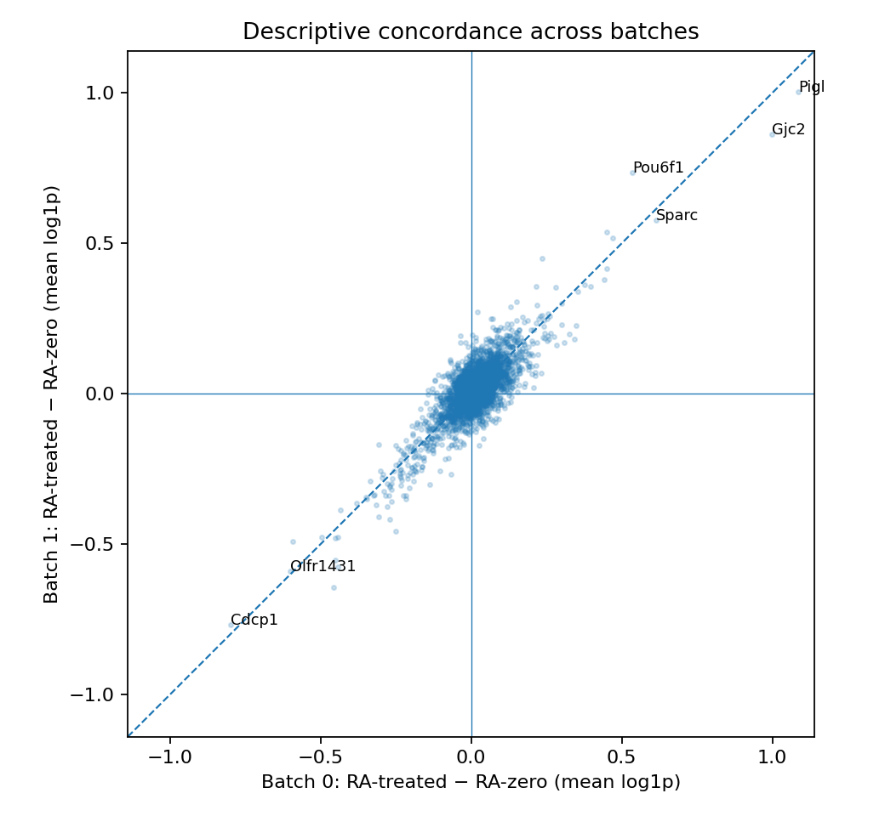

# scDrugFlow

**A small, reproducible Nextflow DSL2 workflow for exploratory single-cell drug-perturbation analysis.**

scDrugFlow demonstrates how to inspect an AnnData dataset, make treatment definitions explicit, and report *descriptive* gene-expression differences without treating individual cells as independent biological replicates. It is a portfolio/research software example, **not** a production-ready nf-core workflow or a validated drug-discovery tool.

**Status (November 2026):** Tested on an Ubuntu research server with Python 3.11, Java 21 and Nextflow 26.10.6: **18 Python tests passed**, and the synthetic and real-data Nextflow workflows completed successfully. The Nextflow end-to-end run is documented here but is **not** currently part of automated GitHub Actions testing.

## What it does

The DSL2 workflow accepts **one `.h5ad` dataset per run** and supports three modes:

| Mode | Processes | Purpose |
| --- | --- | --- |
| `inspect` | `INSPECT` | Report metadata, matrix/layers, candidate treatment columns and expression scale clues. |
| `analyse` | `INSPECT` + `ANALYSE` | Exploratory QC, PCA and descriptive group comparisons, primarily illustrated using synthetic count data. Count versus already-normalised input must be declared explicitly. |
| `ra` | `INSPECT` + `RA_CONTRAST` + `RA_QUALITY` | Gehring–Pachter case study: an RA dose comparison matched on three other treatment doses and stratified by batch, with independent result verification and gene-detection summaries. |

The analyses use **Python / AnnData / Scanpy**; Nextflow orchestrates the steps and publishes reproducible outputs. The `local` profile uses your already-activated Python environment; the `conda` profile lets Nextflow manage the environment.

## Example result: retinoic acid in mouse neural stem cells

The [scPerturb Gehring–Pachter dataset](https://zenodo.org/records/13350497) contains **20,382 cells and 13,256 genes**. The four drug-factor names are constant across cells; the experimental conditions are specified by **four dose columns**. Consequently, grouping cells by the `perturbation` name alone would be incorrect.

For one matched exploratory contrast, we hold **BMP4 at 8 ng/mL**, **EGF/bFGF at 200 ng/mL** and **Scriptaid/decitabine mixture at 0 µM**, while comparing **0 versus 10 µM retinoic acid (RA)** within batches 0 and 1:

| Batch | RA 0 µM (cells) | RA 10 µM (cells) |
| --- | ---: | ---: |
| 0 | 661 | 510 |
| 1 | 591 | 537 |
| **Total** | **1,252** | **1,047** |

The input `.h5ad` contains non-integer `X` values, no count layer, and the sampled `sum(expm1(X))` is close to 10,000. These observations strongly **suggest** log1p library-size-normalised expression but do not independently establish upstream provenance. Accordingly, the RA mode **does not treat `X` as raw counts, normalise it again, or run count-based differential expression**.

For every gene, the output reports (RA 10 − RA 0) **difference in mean stored log1p expression**, calculated separately within batches and then averaged with *equal batch weights*. This is **not a log2 fold change**.



*Figure: Gene-wise RA-associated differences in mean stored log1p expression in batches 0 and 1. Dashed line = equal difference in both batches. In this particular run, the descriptive Pearson correlation was **r = 0.789**. A total of **319 genes** had |difference| ≥ 0.1 in both batches; all 319 had the same sign. These are descriptive checks, **not statistical significance, independent replication or proof of an RA-specific causal effect**.*

**Key limitation:** `batch` has **not been verified to identify independent biological replicates**. Cells are not treated as independent replicate experiments. No p-values, FDR-adjusted results, drug efficacy claims or pathway-enrichment claims are produced. RA 0 µM is a matched reference, **not an entirely untreated culture** (other factors remain present).

## Requirements

- Linux or macOS (or Windows with WSL2)
- Python 3.11 + packages in `environment.yml` (or `requirements.txt`)
- Nextflow and a compatible Java runtime (Java 21 was used for the documented run)
- Conda/Mamba for the managed-environment profile (optional when using an activated environment)

Example Conda setup from the repository root:

```bash
conda env create -f environment.yml
conda activate scdrugflow
python -m pytest -q
```

If you already have an environment at a custom location, activate that instead. The version-pinned dependency lists aid reproducibility but are **not** fully platform-specific lockfiles.

## Quick start: synthetic count data

```bash
python scripts/make_toy.py --output data/toy.h5ad

nextflow run main.nf -profile local \
  --input data/toy.h5ad \
  --mode analyse \
  --min_genes 10 \
  --min_counts 30 \
  --min_group_cells 10 \
  --outdir results/toy
```

The toy data are synthetic, and these results are only a software smoke test. Output files appear in `results/toy/`, including `analysis/processed.h5ad`, `analysis/summary.json` and `analysis/pca.png`.

For Nextflow-managed Conda rather than an already-activated Python environment, use `-profile conda` and ensure Conda is available.

## Real-data case study: reproducible steps

**1. Download the public data (not stored in this repository):**

```bash
mkdir -p data
curl -fL --retry 3 \
  -o data/GehringPachter2019.h5ad \
  'https://zenodo.org/records/13350497/files/GehringPachter2019.h5ad?download=1'

echo '8348716d9d00c9526be4f51748ea7b98  data/GehringPachter2019.h5ad' | md5sum -c -
```

**2. Inspect metadata and audit the design:**

```bash
nextflow run main.nf -profile local \
  --input data/GehringPachter2019.h5ad \
  --mode inspect --outdir results/gehring_inspect

python scripts/audit_gehring.py \
  --input data/GehringPachter2019.h5ad \
  --outdir results/gehring_audit
```

**3. Run the pre-specified RA comparison and validation:**

```bash
nextflow run main.nf -profile local \
  --input data/GehringPachter2019.h5ad \
  --mode ra \
  --ra_bmp4 8 \
  --ra_egf_bfgf 200 \
  --ra_mix 0 \
  --ra_dose 10 \
  --ra_batches 0,1 \
  --min_group_cells 20 \
  --outdir results/gehring_ra_qc
```

Outputs (generated locally; not checked into Git):

```text
results/gehring_ra_qc/
├── inspection.json
├── ra_analysis/
│   ├── contrast_summary.json
│   ├── group_counts.tsv
│   ├── per_batch_gene_differences.tsv
│   ├── gene_differences.tsv
│   └── top_genes.png
└── ra_quality/
    ├── quality_summary.json
    ├── gene_quality.tsv
    ├── top20_gene_quality.tsv
    └── batch_concordance.png
```

See [RA case-study methods](docs/ra_case_study.md), [quality-control notes](docs/ra_quality.md), [metadata audit](docs/gehring_audit.md), and [scientific safeguards](docs/scientific_safeguards.md).

## Testing and limitations

```bash
python -m pytest -q
```

The test suite covers numerical calculations (including sparse/dense matrices), selection and validation logic, and Python integration on small synthetic AnnData inputs. GitHub Actions runs the Python suite on pushes and pull requests; **Nextflow execution is not tested by CI**. We ran the full Nextflow modes manually on an Ubuntu research server. The current code handles a single input dataset and a deliberately fixed two-batch RA case study, not arbitrary multidrug trial designs, cloud deployment or general statistical differential expression.

## Data and attribution

- Harmonised dataset: Peidli S, Green TD et al. (2024). *scPerturb: harmonized single-cell perturbation data.* *Nature Methods* 21, 531–540. [DOI: 10.1038/s41592-023-02144-y](https://doi.org/10.1038/s41592-023-02144-y).
- Original experiment: Gehring J, Park JH, Chen S, Thomson M & Pachter L (2020). *Highly multiplexed single-cell RNA-seq by DNA oligonucleotide tagging of cellular proteins.* *Nature Biotechnology* 38, 35–38. [DOI: 10.1038/s41587-019-0372-z](https://doi.org/10.1038/s41587-019-0372-z).
- Dataset release: [Zenodo 13350497](https://zenodo.org/records/13350497). The `.h5ad` is downloaded separately and is **not** redistributed with this code.

